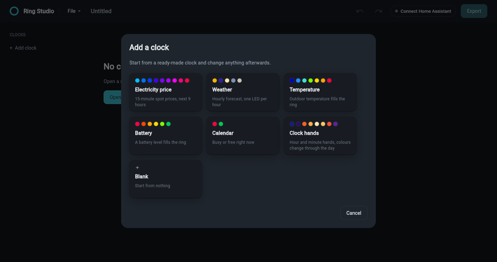
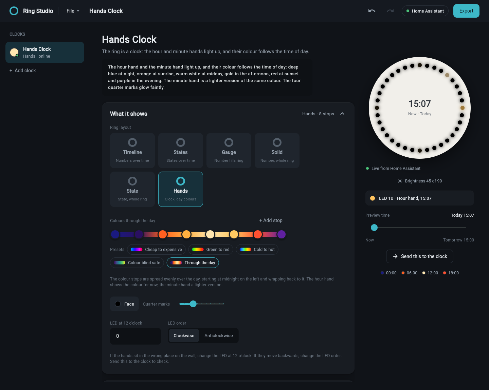
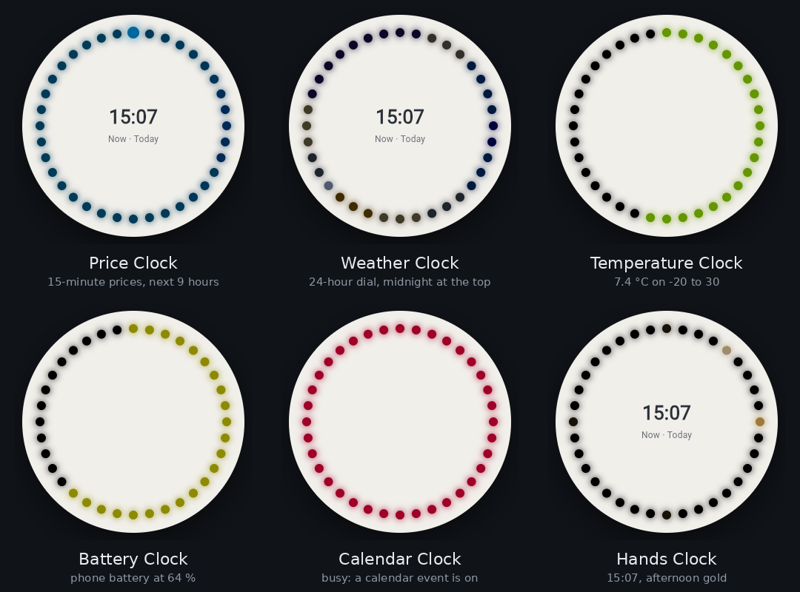

# Ring Studio

Design, preview and flash LED ring clocks that show Home Assistant data. The
clocks run ESPHome and talk only to your Home Assistant, never to the internet.


## Highlights

- Colour a 36 LED ring from any Home Assistant entity: electricity prices, the
  weather forecast, a temperature, a battery level, a calendar or the time.
- Preview the ring at any time the data covers, then push the preview to the
  real clock to check it on the wall.
- Pick entities by name. The app reads their data and fills in the settings.
- Back up, flash and restore the clock over USB, then update it over WiFi.
  ESPHome is installed for you.
- Keep your work in a project file with notes. Export writes clean YAML.
- Passwords and keys stay in your system keychain.
- Runs on Windows, Linux (including Arch) and macOS.

## How it works

Home Assistant does the work. A template sensor turns your entity into 36
colours, one per LED, and the clock shows the colours it receives. Changing
what a clock shows only changes the template, so the clock is not reflashed
for that.

Ring Studio writes both parts: the ESPHome firmware for the clock, and the Home
Assistant template and brightness automation. It previews the result with live
data from your Home Assistant.

## Requirements

| | |
| --- | --- |
| Python | 3.11 or newer |
| Home Assistant | a recent version and a [long-lived access token](https://www.home-assistant.io/docs/authentication/#managing-account-access) |
| Clock | an ESP8266 with a WS2812 ring. Tested on the EnergiKlockan EMIL (GPIO12, 36 LEDs) |
| Cable | a USB data cable for the first flash. Later updates go over WiFi |

## Install

Download this folder, then start the app:

- **Windows:** double-click `run.bat`.
- **Linux and macOS:** open a terminal in the folder and run `./run.sh`.

The first start creates a private Python environment in `.venv` and installs
what the app needs into it. Nothing is installed into your system Python.

On **Arch Linux**, install these packages first:

```sh
sudo pacman -S --needed python gtk3 libsecret
```

On **Debian and Ubuntu**:

```sh
sudo apt install python3 python3-venv libgtk-3-0 libsecret-1-0
```

## Quick start

1. Click **Connect Home Assistant**. Enter its address and paste a long-lived
   access token.
2. Choose **File** > **Open project** and open `examples/Home Clocks.ringstudio`.
   Or click **Add clock** and pick a starter.
3. In **What it shows**, click **Change** and pick your entity. The settings
   fill themselves in.
4. Check the ring on the right. Drag **Preview time** to see later hours.
5. Plug in the clock. In **Device**, click **Flash and back up**, then
   **Back up stock**, then **Flash over USB**.
6. In Home Assistant, open **Settings** > **Devices & services**. The clock is
   found automatically. When asked for the encryption key, paste the API key
   shown in **WiFi and keys**.
7. Click **Export** and write the files to your Home Assistant config, or turn
   on **Send straight to Home Assistant**.

> [!WARNING]
> Back up the stock firmware before the first flash. It is the only way back to
> the original firmware.



## Using Ring Studio

### Layouts

| Layout | Input | What the ring shows |
| --- | --- | --- |
| Timeline | a list of numbers with times | one LED per item, starting at now |
| States | a list of states | one LED per item |
| Gauge | one number | the number fills the ring |
| Solid | one number | the whole ring in the number's colour |
| State | one state | the whole ring in the state's colour |
| Hands | the time | an analog clock with lit hour and minute hands |

Timeline and States can also use a **24-hour dial** (under **Hours on the
ring**): midnight is at the top and every hour keeps its place, 00-01, 01-02
and so on, showing the next 24 hours. With 36 LEDs the hours take 1 or 2 LEDs
each, because 36 does not split evenly into 24. The current hour is the bright
one. The dial needs the time of each item, which the app finds by itself when
you pick the entity. If the hours sit in the wrong place, change **LED at 12
o'clock** or **LED order**.

Numbers use a gradient. Click a dot on the gradient to change that colour, or
pick a preset: cheap to expensive, green to red, cold to hot, colour-blind safe
or through the day. States use a table with a colour, the state, what it means
in plain words and an optional note.

### Choosing an entity

Click **Change** next to the entity to open the picker.


- Search by name or entity ID.
- **Fits** lists only entities whose data suits the clock's layout.
  **All entities** lists everything.
- Click an entity to see its value, its attributes and what the app will set.
- **Reload from Home Assistant** fetches fresh data.

Picking an entity fills in **Data mapping**: the list attributes to read, the
value key, the start and end time keys, and a low and high end that cover the
data. Change any field by hand, or click **Detect from the entity again**.

The low and high ends cover the data the entity holds right now. For prices,
raise **High end** if you want room for expensive days.

### Preview

- Point at an LED to see its time and value, for example
  `LED 13 · Tomorrow 17:30 · 0.26335 SEK/kWh`, or on a 24-hour dial
  `LED 1 · 00-01 Tomorrow · Partly cloudy (partlycloudy)`.
- Drag **Preview time** to see the ring later today or tomorrow.
- For clocks that follow the sun, the preview is dimmed as the clock will be at
  that time.
- **Send this to the clock** shows the preview on the real ring until the
  template next updates, within a minute. **Stop** ends it at once.

### Hands layout



The ring becomes an analog clock. It needs no entity.

- The hour hand shows the colour for the time of day. The minute hand shows a
  lighter version of the same colour.
- The colour stops are spread over 24 hours, starting at midnight.
- **Quarter marks** light 12, 3, 6 and 9 o'clock. Set them to 0 to turn them
  off.
- If the hands point to the wrong place, change **LED at 12 o'clock**. If they
  move backwards, switch **LED order**.

### Brightness

One shared automation dims the ring with the sun and turns it off at night. A
bar chart shows today's brightness every half hour at your Home Assistant
location. Set **Off from** to 24 to keep the ring on all night.

### Projects and notes

**File** has New project, Open project, Save, Save as, Project notes and Open
repo. A project is one `.ringstudio` file in plain YAML:

```yaml
ring_studio: 1
name: Home Clocks
clocks:
- name: weather_clock
  display_name: Weather Clock
  note: Hourly forecast, one LED per hour.
  shows:
    layout: states
    entity: sensor.weather_hourly
    states:
      sunny:
        colour: '#FFB000'
        means: Sunny
```

Notes can go on the project, on each clock and on each state. They stay in the
project file and are never exported.

Each save keeps the previous version as `<name>.ringstudio.bak`. Edits are also
kept in a draft, so unsaved changes come back if the app closes.

**Open repo** reads an existing folder or zip with `config/` and
`homeassistant/` folders and turns it into a project.

### Flashing


**Device** > **Flash and back up** lists anything that would make the flash
fail, with a button to fix it.

| Button | What it does |
| --- | --- |
| Back up stock | reads all 4 MB from the clock and checks the copy |
| Flash over USB | compiles and flashes ESPHome. The first compile downloads the toolchain and takes a few minutes |
| Update over the air | the same over WiFi, after the first flash |
| Restore stock | writes the backup back to the clock |

Each job shows its steps with a progress bar. **Show details** opens the full
output, and opens by itself if a step fails.

### Export

**Export** writes only the files that are new or changed. **View** shows a
file, or only the changed lines of a changed file.

| File | Contents |
| --- | --- |
| `config/<name>.yaml` | ESPHome firmware |
| `config/secrets.yaml` | WiFi and keys |
| `homeassistant/ha_<name>_ring.yaml` | template sensor |
| `homeassistant/automation.yaml` | brightness automation |
| `<packages folder>/ring_studio.yaml` | everything for Home Assistant in one package |

Exported files have no notes or comments, only a first line naming the project
they came from.

**Send straight to Home Assistant** writes the package into Home Assistant's
packages folder, for example `\\server\config\packages`, and reloads it.
Packages must be turned on once in `configuration.yaml`:

```yaml
homeassistant:
  packages: !include_dir_named packages
```

### Keyboard shortcuts

| Keys | Action |
| --- | --- |
| `Ctrl`+`S` | Save |
| `Ctrl`+`Shift`+`S` | Save as |
| `Ctrl`+`Z` | Undo |
| `Ctrl`+`Y` | Redo |
| `Ctrl`+`E` | Export |

## Examples

The `examples` folder has seven projects. Open one and change the entities to
your own.



| File | Contents |
| --- | --- |
| `Home Clocks.ringstudio` | the price clock and the weather clock together |
| `Price Clock.ringstudio` | 15-minute electricity prices for SE3 |
| `Weather Clock.ringstudio` | the hourly forecast on a 24-hour dial |
| `Temperature Clock.ringstudio` | outdoor temperature as a gauge, -20 to 30 |
| `Battery Clock.ringstudio` | a battery level as a gauge |
| `Calendar Clock.ringstudio` | red while a calendar event is on, green when free |
| `Hands Clock.ringstudio` | an analog clock that stays on all night |

<details>
<summary>Weather colours</summary>

Warm colours are dry daytime, blues are rain, whites and cyans are snow and ice,
purple is thunder, green is wind and red is exceptional weather.

| State | Shown as | Colour |
| --- | --- | --- |
| sunny | Sunny | `#FFB000` |
| clear-night | Clear night | `#3020A0` |
| partlycloudy | Partly cloudy | `#FFE6A0` |
| cloudy | Cloudy | `#8090B0` |
| fog | Fog | `#C8C0B0` |
| rainy | Rain | `#0064FF` |
| pouring | Heavy rain | `#0010FF` |
| snowy | Snow | `#E0F0FF` |
| snowy-rainy | Sleet | `#80D0FF` |
| hail | Hail | `#40FFE0` |
| lightning | Thunder | `#A000FF` |
| lightning-rainy | Thunder and rain | `#6000FF` |
| windy | Windy | `#00D090` |
| windy-variant | Windy and cloudy | `#40A090` |
| exceptional | Exceptional | `#FF2000` |

</details>

The screenshots were taken from the app with sample Home Assistant data at
15:07. The previews are dimmed by the brightness automation for that time of
day.

## Security

WiFi passwords, API and OTA keys and the Home Assistant token are kept in the
system keychain: Windows Credential Manager, macOS Keychain, or GNOME Keyring or
KWallet on Linux. Without a keychain they go in
`~/.config/ring-studio/secrets.json`, readable only by your account. They are
never written to project files, the draft or the settings.

<details>
<summary>Details</summary>

- The token goes only to the address you entered, never on a redirect, and
  certificates are always checked. A plain `http://` address outside your home
  network shows a warning.
- The fallback hotspot gets a random password, so nobody nearby can join it and
  change the clock's WiFi.
- Project files and repos from other people are checked before use. Pins,
  boards, entities and names that could change the firmware are refused.
- Zip files are unpacked with size and path limits into a temporary folder that
  is deleted after reading.
- `secrets.yaml` is readable only by you, is added to `.gitignore` in git repos
  and is never shown in **View**. Export warns if git already tracks it.
- The app folder, stock backups and the flash build are readable only by you.
  The build's copy of `secrets.yaml` is deleted after each flash.
- ESPHome and esptool run with fixed arguments, never through a shell.

</details>

## Troubleshooting

| Problem | Fix |
| --- | --- |
| "The token was not accepted" | Make a new long-lived token in your Home Assistant profile and paste it again. |
| No serial port on Ubuntu | The braille service takes the CH340 chip. Run `sudo apt remove brltty` and plug the clock in again. |
| Permission denied on the port | Add yourself to the port's group and log in again: `sudo usermod -aG dialout $USER` (`uucp` on Arch). |
| "Python was not found" when flashing from a built app | Install Python 3.11 or newer. On Windows, tick "Add python.exe to PATH". |
| The hands or the dial hours are in the wrong place | Change **LED at 12 o'clock** or **LED order**. |
| The clock does not appear in Home Assistant | Check the WiFi name and password in **WiFi and keys**, then flash again. |

## Where the app keeps its files

| System | Folder |
| --- | --- |
| Windows | `%USERPROFILE%\.ring_studio` |
| macOS | `~/Library/Application Support/Ring Studio` |
| Linux | `~/.config/ring-studio` |

The folder holds settings, the draft, stock backups and the flash build.

## Building a standalone app

Run `build_windows.bat` on Windows or `./build_linux.sh` on Linux. The app is
written to `dist/`. Flashing from a built app still needs Python on the
computer, because ESPHome is a Python program.

## Development

```sh
python -m venv .venv
.venv/bin/pip install -r requirements.txt pytest
.venv/bin/python -m pytest tests
```

The tests check that generated templates give the same colours as the
hand-written originals, that projects and repos round-trip, and the security
rules above.

## Feedback

Bug reports and ideas are welcome as GitHub issues.
