# Ring Studio

Design, preview and set up LED ring clocks that show Home Assistant data. The
clocks run ESPHome and talk only to your Home Assistant, never to the internet.

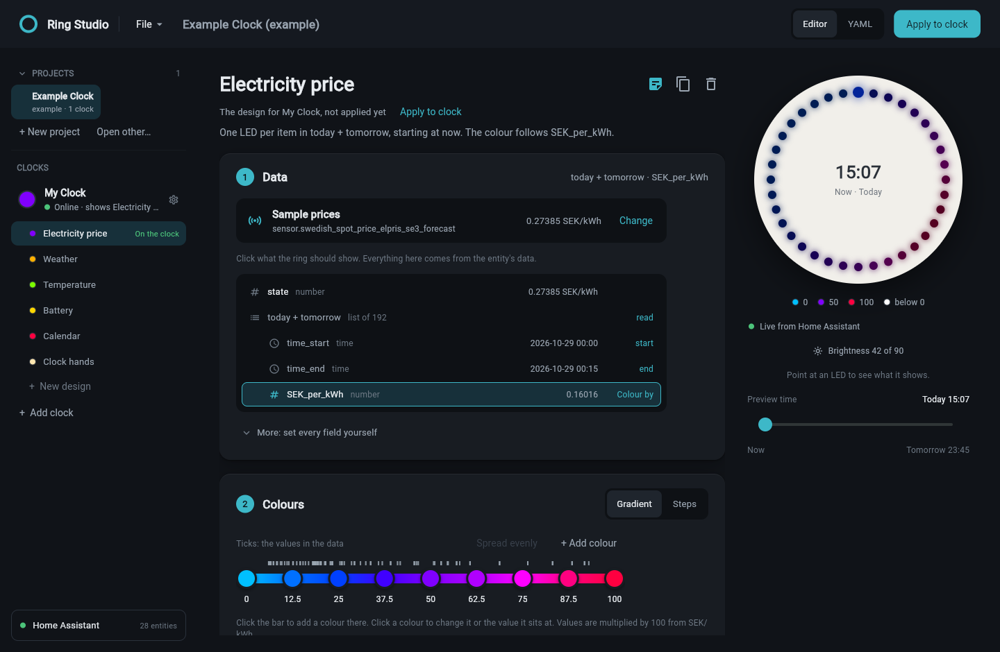

## Highlights

- Colour a 36 LED ring from Home Assistant: electricity prices, the weather,
  wind or lightning on a compass, a countdown to the next tram, doors and
  windows, shifts and bin days, a calendar, any sensor, or the time.
- **New design** offers nine setups that find their own data in your Home
  Assistant and ask one or two questions. Or build any design from scratch.
- Keep a library of designs per clock and switch between them with one click,
  without reflashing.
- Preview the ring at any time the data covers, and try it on the real clock.
- **Apply to clock** sends the design to Home Assistant and checks that the
  clock gets it.
- A setup checklist takes a new clock through backing up, flashing and adding
  it to Home Assistant. ESPHome is installed for you.
- The clock dims itself from Home Assistant's `sun.sun`, without any
  automation.
- Your projects are listed on the left, and the YAML view lets you write a
  whole project by hand.
- Passwords and keys stay in your system keychain.
- Runs on Windows, Linux (including Arch) and macOS.

## How it works

A clock shows one design at a time. In Home Assistant, a template sensor turns
the design's data into 36 colours, one per LED, and the clock shows the
colours it receives. Every layout runs in that template. Switching designs only changes that template sensor, so the
clock is not reflashed for it.

The clock's firmware is ESPHome. It reads the sun's elevation from Home
Assistant's `sun.sun` and dims the ring by itself, so no automation is needed.

## Requirements

| | |
| --- | --- |
| Python | 3.11 or newer |
| Home Assistant | a recent version and a [long-lived access token](https://www.home-assistant.io/docs/authentication/#managing-account-access) from an administrator account |
| Clock | an ESP8266 with a WS2812 ring. Tested on the EnergiKlockan EMIL (GPIO12, 36 LEDs) |
| Cable | a USB data cable for the first flash. Later updates go over WiFi |

## Install

Download this folder, then start the app:

- **Windows:** double-click `run.bat`.
- **Linux and macOS:** open a terminal in the folder and run `./run.sh`.

The first start creates a private Python environment in `.venv` and installs
what the app needs into it. Nothing is installed into your system Python.

On **Arch Linux**, install these packages first:

```sh
sudo pacman -S --needed python gtk3 libsecret
```

On **Debian and Ubuntu**:

```sh
sudo apt install python3 python3-venv libgtk-3-0 libsecret-1-0
```

## Quick start

The app opens with the Example Clock: one clock with six designs and sample
data, so you can try everything before connecting anything. A welcome banner
above the editor says what to do next; close it with the cross, and bring it
back with **File** > **Getting started**.

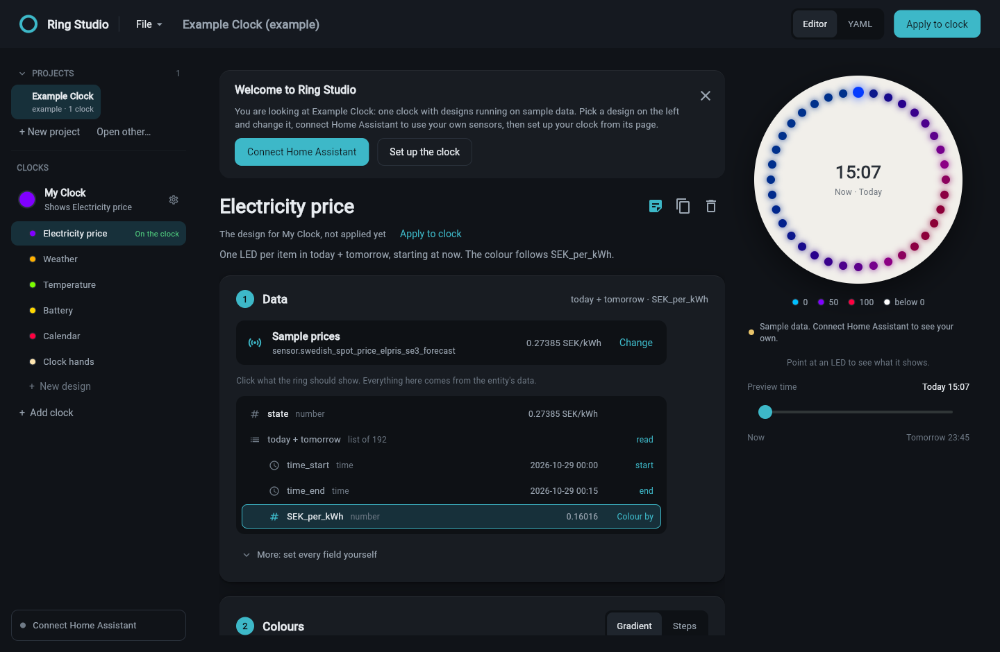

1. Look around: pick a design under **My Clock** on the left, click what it
   shows in **Data**, change its **Colours** and drag **Preview time**.
2. Click **Connect Home Assistant** at the bottom left. Enter its address and
   paste a long-lived access token.
3. Click the clock's name on the left. Its **Setup** checklist takes you
   through the rest: back up the stock firmware, set your WiFi and flash the
   clock, and add it in Home Assistant.
4. Click **New design** under the clock and pick a setup, or open a design and
   click **Change** under **Data** to pick your own entity.
5. Click **Apply to clock**. The clock shows the design within a minute.

> [!WARNING]
> Back up the stock firmware before the first flash. It is the only way back to
> the original firmware.

## Using Ring Studio

### The window

- **Projects** lists every `.ringstudio` file in your projects folder, newest
  first, then projects you opened from elsewhere, then the Example Clock. Click
  one to open it; unsaved changes are asked about first. Click **PROJECTS** to
  fold the list away. The folder is `Documents/Ring Studio`; change it with
  **File** > **Projects folder**.
- **Clocks** lists your clocks and, under each one, its designs. The dot and
  word under a clock's name say whether it is **Online**, **Offline** or **Not
  set up** in Home Assistant. **On the clock** marks the design it shows.
- **Home Assistant** at the bottom shows whether the app is connected. Click it
  to change the address or token.
- **File** holds New project, Open, Save, Save as, Undo, Redo, Project notes,
  Projects folder and Getting started.

### Clocks and designs

- Click a design to edit it. The preview shows that design, even when another
  one is on the clock.
- **Apply to clock** puts the open design on its clock. Only one design is on a
  clock at a time; the others stay in the library for later.
- Under the design's name, a line says whether it is on the clock and whether
  you changed it since it was applied, with **Apply to clock** next to it.
- Click the name to rename the design. The note icon holds a note only for you,
  and the copy and bin icons duplicate or delete the design. The design on the
  clock cannot be deleted until another one is applied.
- **Add clock** adds another physical clock.

### New design

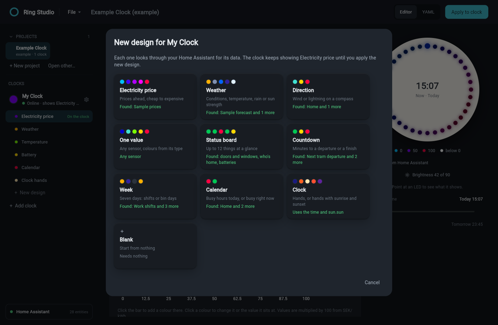

**New design** under a clock opens nine setups and Blank. Each tile says what
it found in your Home Assistant, or what it needs.

| Setup | Questions |
| --- | --- |
| Electricity price | all prices or only the cheapest hours; from now or on a 24-hour dial |
| Weather | conditions, temperature, rain or sun strength; from now, 24 hours or the week |
| Direction | wind or lightning, on a compass |
| One value | any sensor, as a fill or on the whole ring, with colours that suit its type |
| Status board | doors and windows, who is home, batteries, plants or network |
| Countdown | the next departure, a timer or an appliance |
| Week | shifts or bin days |
| Calendar | today's busy hours, or busy or free right now |
| Clock | hands, or a 24-hour face with sunrise and sunset |

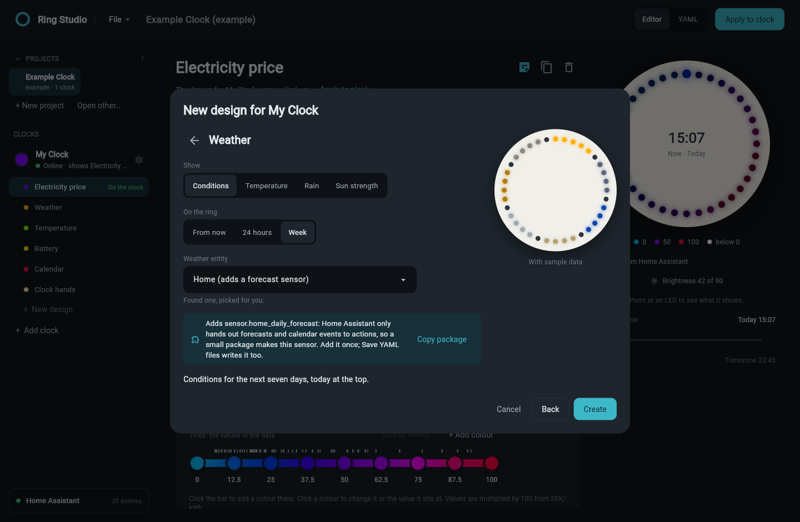

Pick the answers, check the entity it picked (the best match is picked for
you), look at the ring, and click **Create**. Everything can be changed
afterwards in the editor.

Since Home Assistant 2024.3, weather forecasts and calendar events are only
handed out by an action, and a template cannot call actions. For those, the
setup adds a small package that makes a sensor holding the forecast or the
events: **Copy package** copies it, ready to paste into a file in your
`config/packages` folder, and **Save YAML files** writes it as
`homeassistant/ring_studio_sources.yaml`. If you already have a sensor with a
forecast list, such as a trigger-based template sensor, the setup uses that
instead. After adding the package, restart Home Assistant once.

### Setting up a clock

Click the clock's name to open its page.

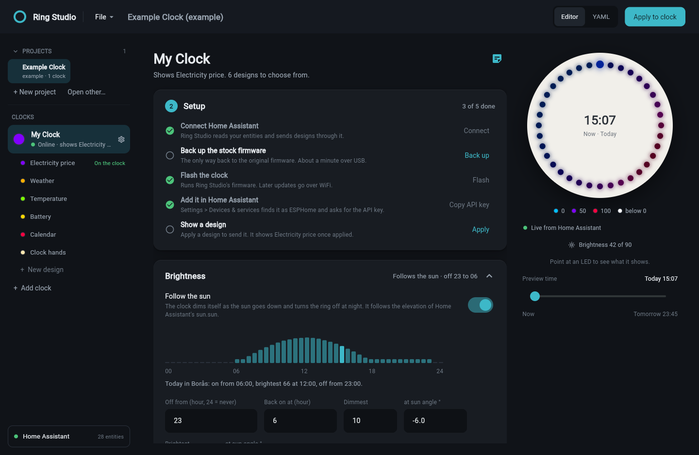

**Setup** is a checklist that ticks itself off from what Home Assistant
reports:

1. Connect Home Assistant.
2. Back up the stock firmware.
3. Flash the clock. The flash dialog asks for your WiFi first. Later, when
   brightness or hardware settings change, this step asks you to update the
   clock over WiFi.
4. Add it in Home Assistant. **Settings** > **Devices & services** finds it as
   ESPHome and asks for the encryption key: **Copy API key** copies it.
5. Show a design.

Once everything is done, the checklist folds to one line saying what the clock
shows.

Below it are **Brightness** and **Name and hardware**: the clock's name, where
12 o'clock is on the ring and which way the LEDs run, the hardware, and the
flash dialog.

### Renaming a clock

A clock has one name. The device name on the network and in ESPHome is made
from it: **Kitchen Clock** becomes `kitchen_clock` at `kitchen_clock.local`.

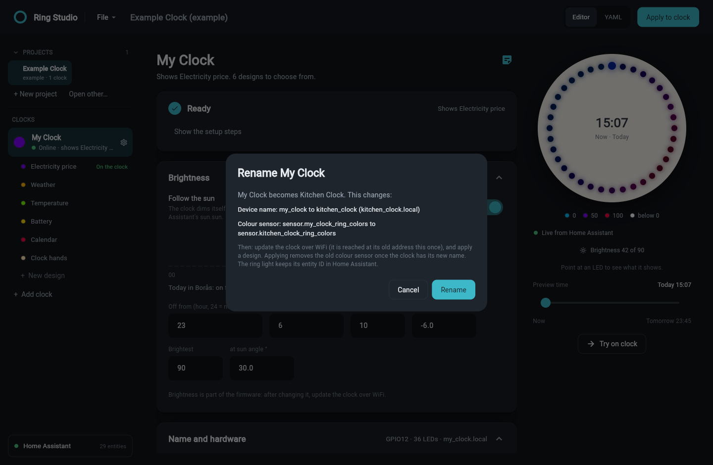

Renaming a clock that is already set up shows what changes first. Then update
the clock over WiFi (the app reaches it at its old address this once) and apply
a design. Applying removes the colour sensor the clock had under its old name,
but only once the clock runs firmware with the new name, and only a helper
Ring Studio made. Home Assistant keeps the ring light's entity ID. What the app
remembers about a clock, such as its backup and whether it was flashed, stays
with it through renames.

### Applying a design

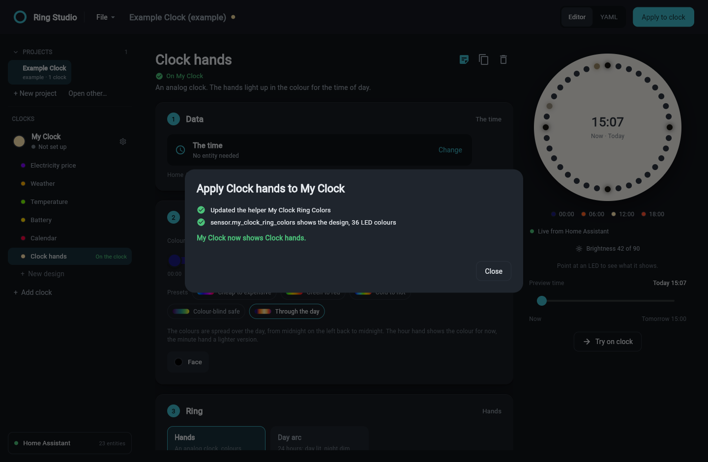

**Apply to clock** sends the open design to Home Assistant and then checks it:

- The clock's colours become a template sensor helper under **Settings** >
  **Devices & services** > **Helpers**, for example **My Clock Ring Colors**
  (`sensor.my_clock_ring_colors`). Each clock has exactly one; applying another
  design updates it.
- The app waits until the sensor shows the same colours as the preview, and
  says so. If something fails, the line says why.
- Nothing Ring Studio did not make is changed.

It needs a token from an administrator account, because Home Assistant lets
only administrators add helpers.

If you added Ring Studio's YAML files to Home Assistant by hand before, remove
those files and restart Home Assistant first. Ring Studio then clears the
entities those files left behind, so the helper keeps the same entity ID.
Earlier versions also made a brightness automation; once the clock has this
version's firmware, the apply dialog offers to remove it.

### Building a design

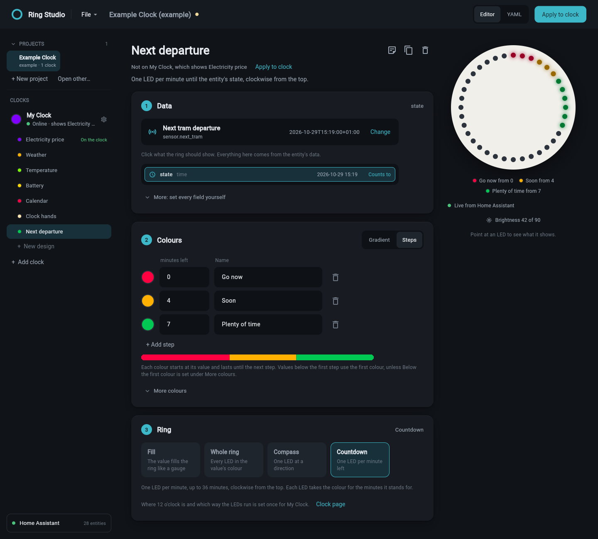

A design is set up in three steps.

**1 Data.** Click **Change** to pick an entity, or **The time** at the top of
the list for the clock faces. For an entity, the app lists everything it holds:
the state, every attribute and the fields inside its lists, each with a sample
value. Click the one the ring should show. What you click decides the rest:

| You click | The ring shows |
| --- | --- |
| a number inside a list | one LED per item, coloured by that number |
| a text inside a list | one LED per item, one colour per text value |
| the state or an attribute holding a number | the number, as a fill or on the whole ring |
| the state or an attribute holding a time | a countdown to that time |
| the state or an attribute holding text | the whole ring, one colour per text value |

Times inside lists are found by themselves and tagged **start** and **end**.
**Multiply by** is set from the unit, so a price in SEK/kWh is shown in öre.
**More** shows every field to type by hand.

For a compass, **Colour from** picks a second entity whose value colours the
pointer, such as wind speed or the distance to the lightning. For segments, the
list of parts takes the place of the entity: up to 12, in order clockwise from
the top, each with a name.

**2 Colours.** Numbers are coloured in one of two ways:

- **Gradient**: colours blend smoothly from one value to the next. Click the
  bar to add a colour at that value, or click a colour to change it or the
  value it sits at. Ticks above the bar show the values in the data.
  **Spread evenly** puts the colours back at equal distances.
- **Steps**: each colour starts at its value and lasts until the next step,
  for example Cheap from 0, Normal from 50, Pricey from 100. Step names show in
  the legend and when you point at an LED.

Text gets a table with a colour, the value, what it means in plain words and
an optional note. **Add the values in the data** adds every value the entity
holds right now. **More colours** sets the colours for values below the first
colour, for any value without its own colour, and for LEDs without data.

**3 Ring.** Where the colours go. The choices depend on the data:

| Data | Layouts |
| --- | --- |
| a list | **From now**, one LED per item; **24-hour dial**, midnight at the top with every hour in its place; **Week**, seven sections with today at the top |
| one value | **Fill**, **Whole ring**, **Compass** or **Countdown** |
| several entities | **Segments** |
| the time | **Hands** or **Day arc** |

The layout names are the same as in the project file. Where 12 o'clock is and
which way the LEDs run belong to the clock, so they are set once on the clock's
page and every design uses them.

### The layouts

| Layout | What it shows |
| --- | --- |
| From now | one LED per list item, starting at now and running clockwise |
| 24-hour dial | every hour in its place, the next 24 hours, midnight at the top. With 36 LEDs the hours take 1 or 2 LEDs each |
| Week | seven sections, today at the top and the brightest, with a dark LED between days |
| Fill | the value fills the ring from **Empty at** to **Full at** |
| Whole ring | every LED in the value's colour |
| Compass | one LED at a direction, north at the top, with faint marks at north, east, south and west |
| Countdown | one LED per minute left, up to 36 minutes, each in the colour for the minutes it stands for |
| Segments | up to 12 parts, one entity each, with a dark LED between parts |
| Hands | an analog clock, whose colours follow the time of day |
| Day arc | a 24-hour face: day lit, night dim, sunrise and sunset marked, now in white |

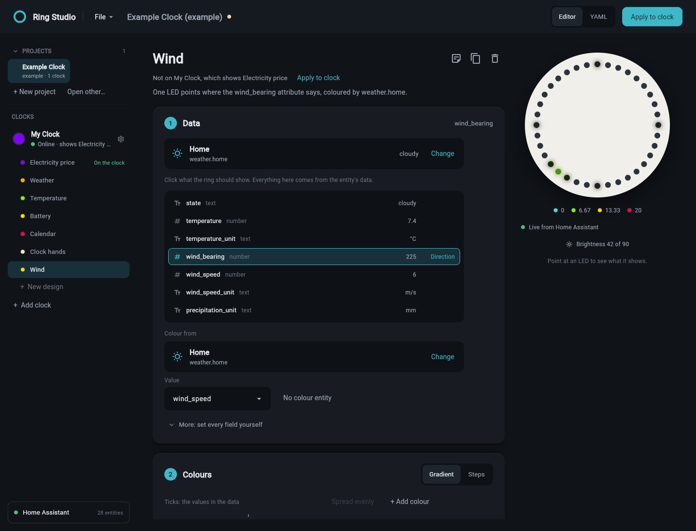

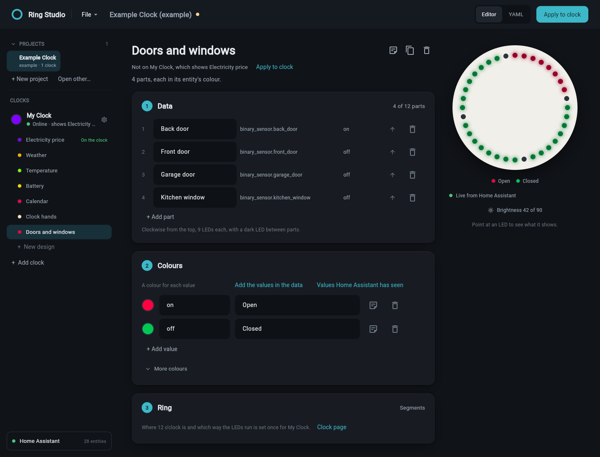

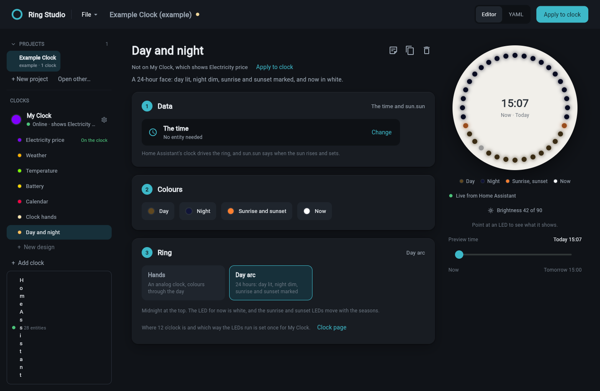

All layouts run in Home Assistant's template, so a clock needs no new firmware
to use them.

### Picking colours

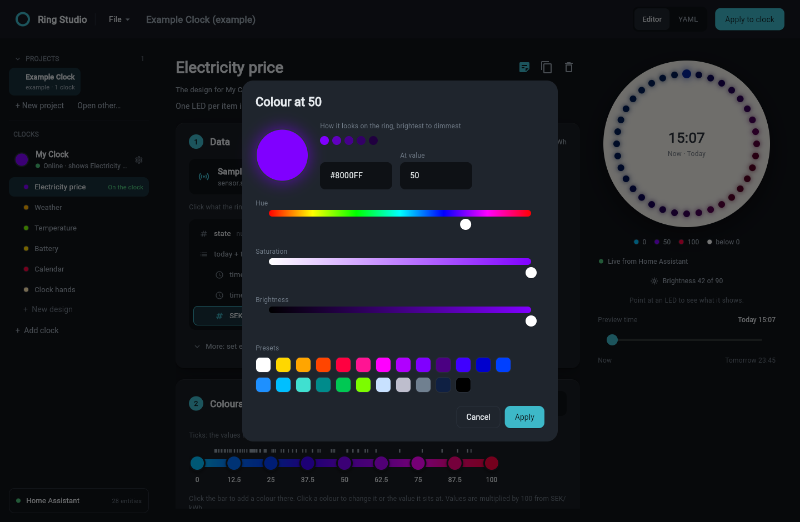

Any colour works. Drag **Hue**, **Saturation** and **Brightness**, type a hex
value, or click a recent colour or a preset. The row of dots shows the colour
as the ring shows it, from full brightness to dim. For gradient colours and
steps, **At value** moves the colour to another value.

### Choosing an entity

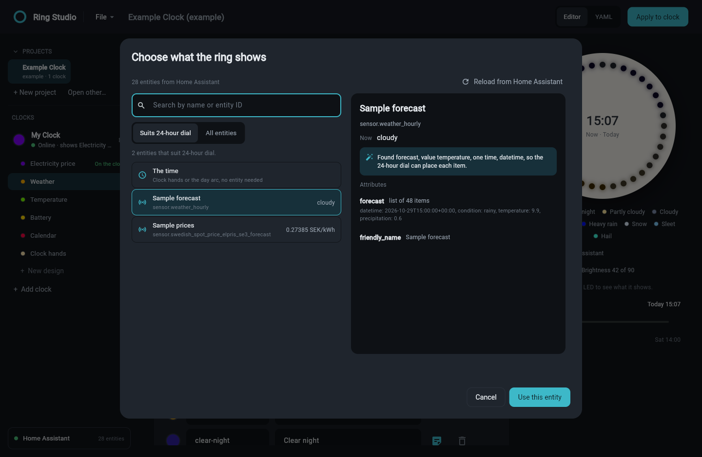

- Search by name or entity ID.
- **Suits** lists only entities whose data suits the layout. **All entities**
  lists everything.
- **The time** at the top turns the design into a clock face.
- Click an entity to see its value, its attributes and what the app will set.
- **Reload from Home Assistant** fetches fresh data.

### Preview

Before Home Assistant is connected, every design previews with sample data, and
the line under the ring says so. Once connected, the preview uses your data. An
entity that does not exist yet, such as a sensor a package will make, gets
sample data until it does.

- The legend under the ring says what the colours mean.
- Point at an LED to see what it shows, for example
  `LED 13 · Today 18:00 · 0.04849 SEK/kWh`, `LED 1 · Back door · Open` or
  `LED 23 · SW (225°), 6 m/s`.
- Drag **Preview time** to see the ring later today or tomorrow.
- For clocks that follow the sun, the preview is dimmed as the clock will be at
  that time.
- **Try on clock** shows the preview on the real ring until its sensor next
  updates, within a minute. **Stop** ends it at once. Unlike **Apply to
  clock**, it changes nothing.

### Brightness

With **Follow the sun** on, the clock dims the ring as the sun goes down and
turns it off at night. The firmware reads the `elevation` attribute of Home
Assistant's `sun.sun` and sets its own brightness from it once a minute, so no
automation is involved. Until the first elevation arrives after a restart, the
brightness stays as it was. Set **Off from** to 24 to keep the ring on all
night.

A bar chart shows today's brightness every half hour. `sun.sun` only reports
the sun as it is now, so the chart and the preview at later times estimate the
elevation for Home Assistant's location.

Brightness is part of the firmware: after changing it, update the clock over
WiFi. The setup checklist reminds you.

With **Follow the sun** off, set the brightness with the clock's **Ring
Brightness** control in Home Assistant.

### The YAML view

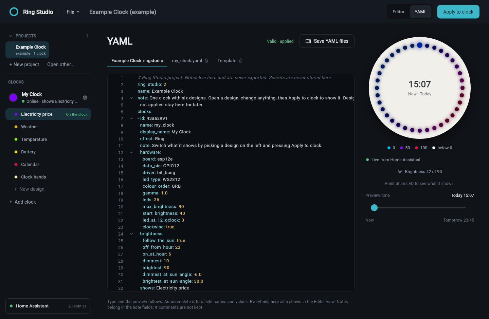

Click **YAML** at the top to edit the whole project as text. Everything the
editor can do is here, and the editor shows whatever you type.

- Changes apply as you type. The preview follows every valid version.
- A problem is marked on its line, with what is wrong. Until it is fixed, the
  preview keeps the last valid version.
- Autocomplete offers field names and values. **Fields** lists every field with
  what it takes, and has a search.
- The other tabs show the ESPHome firmware of the open clock, the Home
  Assistant template of the open design and, when it needs one, its package.
  They are read only. Secrets are never shown.
- **Save YAML files** writes everything to a folder (see below).
- Notes belong in the `note` fields. YAML comments starting with `#` are not
  kept.

A project is one `.ringstudio` file in plain YAML:

```yaml
ring_studio: 2
name: Home
clocks:
- id: 43aa3991
  name: my_clock
  display_name: My Clock
  hardware: {data_pin: GPIO12, leds: 36, led_at_12_oclock: 0, clockwise: true}
  brightness: {follow_the_sun: true, off_from_hour: 23, on_at_hour: 6}
  shows: Electricity price
  designs:
  - name: Electricity price
    layout: from_now
    entity: sensor.swedish_spot_price_elpris_se3_forecast
    list_attributes: [today, tomorrow]
    item_key: SEK_per_kWh
    multiply_by: 100
    colour_by: steps
    steps:
    - {from: 0, colour: '#00C853', means: Cheap}
    - {from: 50, colour: '#FFD700', means: Normal}
    - {from: 100, colour: '#FF7800', means: Pricey}
  - name: Wind
    layout: compass
    entity: weather.home
    value_attribute: wind_bearing
    second_entity: weather.home
    second_attribute: wind_speed
    high: 20
  - name: Doors and windows
    layout: segments
    colour_by: values
    parts:
    - {entity: binary_sensor.front_door, name: Front door}
    - {entity: binary_sensor.back_door, name: Back door}
    states:
      'on': {colour: '#FF0040', means: Open}
      'off': {colour: '#00C853', means: Closed}
```

Notes can go on the project, on each clock, on each design and on each value.
They stay in the project file and are never sent anywhere.

Each save keeps the previous version as `<name>.ringstudio.bak`. Edits are also
kept in a draft, so unsaved changes come back if the app closes. Projects from
earlier versions open as they were, with the old layout names changed to the
new ones.

The example opens as "(example)" in the title. **Save** asks where to keep your
own copy, so the example itself never changes.

### Flashing

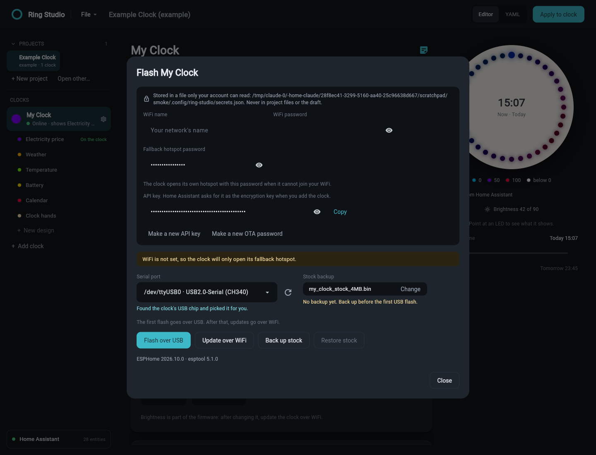

The flash dialog opens from the setup checklist or from **Flash and back up**
under **Name and hardware**. WiFi and keys are at the top: the WiFi name and
password, the fallback hotspot password and the API key. Once WiFi is set they
fold to one line. Anything that would make the flash fail is listed below them.

| Button | What it does |
| --- | --- |
| Back up stock | reads all 4 MB from the clock and checks the copy |
| Flash over USB | compiles and flashes ESPHome. The first compile downloads the toolchain and takes a few minutes |
| Update over WiFi | the same over WiFi, after the first flash |
| Restore stock | writes the backup back to the clock |

Each job shows its steps with a progress bar. **Show details** opens the full
output, and opens by itself if a step fails.

### Save YAML files

**Save YAML files** in the YAML view writes plain YAML into a folder you
choose, for keeping in git or importing yourself. Only new and changed files are
written. **View** shows a file, or only the changed lines of a changed file.

| File | Contents | Goes to |
| --- | --- | --- |
| `config/<name>.yaml` | ESPHome firmware | ESPHome |
| `config/secrets.yaml` | WiFi and keys | ESPHome, next to the clock files |
| `homeassistant/ha_<name>_ring.yaml` | the template sensor for the design on the clock | Home Assistant `config/packages` |
| `homeassistant/ring_studio_sources.yaml` | forecast and calendar sensors designs read, when any do | Home Assistant `config/packages` |

Home Assistant reads packages only with this in `configuration.yaml`. Add it
once and restart. If there already is a `homeassistant:` section, add only the
`packages` line inside it:

```yaml
homeassistant:
  packages: !include_dir_named packages
```

Use either the template files or **Apply to clock** for the same clock, not
both. The sources package is needed either way.

### Keyboard shortcuts

| Keys | Action |
| --- | --- |
| `Ctrl`+`S` | Save |
| `Ctrl`+`Shift`+`S` | Save as |
| `Ctrl`+`Z` | Undo (in the YAML view, undo typing) |
| `Ctrl`+`Y` | Redo |
| `Ctrl`+`E` | Apply to clock |

## The Example Clock

The example is one clock with six designs. Open a design, change the entity to
your own, and save your own copy. Until Home Assistant is connected the designs
preview with sample data.

| Design | Shows |
| --- | --- |
| Electricity price | 15-minute electricity prices for SE3, one LED per price from now |
| Weather | the hourly forecast on a 24-hour dial |
| Temperature | outdoor temperature filling the ring, -20 to 30 |
| Battery | a battery level filling the ring |
| Calendar | red while a calendar event is on, green when free |
| Clock hands | an analog clock whose colours change through the day |

<details>
<summary>Weather colours</summary>

Warm colours are dry daytime, blues are rain, whites and cyans are snow and ice,
purple is thunder, green is wind and red is exceptional weather.

| State | Shown as | Colour |
| --- | --- | --- |
| sunny | Sunny | `#FFB000` |
| clear-night | Clear night | `#3020A0` |
| partlycloudy | Partly cloudy | `#FFE6A0` |
| cloudy | Cloudy | `#8090B0` |
| fog | Fog | `#C8C0B0` |
| rainy | Rain | `#0064FF` |
| pouring | Heavy rain | `#0010FF` |
| snowy | Snow | `#E0F0FF` |
| snowy-rainy | Sleet | `#80D0FF` |
| hail | Hail | `#40FFE0` |
| lightning | Thunder | `#A000FF` |
| lightning-rainy | Thunder and rain | `#6000FF` |
| windy | Windy | `#00D090` |
| windy-variant | Windy and cloudy | `#40A090` |
| exceptional | Exceptional | `#FF2000` |

</details>

The screenshots were taken from the app with sample Home Assistant data at
15:07, and the apply screenshot against a Home Assistant 2025.12.2 test server.
The previews are dimmed as the clock dims itself at that time of day.

## Security

WiFi passwords, API and OTA keys and the Home Assistant token are kept in the
system keychain: Windows Credential Manager, macOS Keychain, or GNOME Keyring or
KWallet on Linux. Without a keychain they go in
`~/.config/ring-studio/secrets.json`, readable only by your account. They are
never written to project files, the draft or the settings.

<details>
<summary>Details</summary>

- The token goes only to the address you entered, never on a redirect, and
  certificates are always checked, also for the websocket connection used to
  clear entities left by removed YAML files. A plain `http://` address outside
  your home network shows a warning.
- The fallback hotspot gets a random password, so nobody nearby can join it and
  change the clock's WiFi.
- Project files from other people are checked before use. Pins, boards,
  entities and names that could change the firmware are refused.
- `secrets.yaml` is readable only by you, is added to `.gitignore` in git repos
  and is never shown in **View**. Saving warns if git already tracks it.
- The app folder, stock backups and the flash build are readable only by you.
  The build's copy of `secrets.yaml` is deleted after each flash.
- ESPHome and esptool run with fixed arguments, never through a shell.

</details>

## Troubleshooting

| Problem | Fix |
| --- | --- |
| "The token was not accepted" | Make a new long-lived token in your Home Assistant profile and paste it again. |
| "not an administrator" when applying | Make the token while logged in as an administrator. |
| A weather or calendar design stays dark | The package that makes its sensor is not in Home Assistant yet. Click **Copy package** in **Data**, paste it into a file in `config/packages` and restart Home Assistant. |
| "already exists and is not a Ring Studio helper" | A YAML file from **Save YAML files** is still in Home Assistant. Remove it, restart Home Assistant and apply again. |
| The ring does not dim | Check that `sun.sun` exists in Home Assistant (the Sun integration, on by default) and that **Follow the sun** is on, then update the clock. |
| No serial port on Ubuntu | The braille service takes the CH340 chip. Run `sudo apt remove brltty` and plug the clock in again. |
| Permission denied on the port | Add yourself to the port's group and log in again: `sudo usermod -aG dialout $USER` (`uucp` on Arch). |
| "Python was not found" when flashing from a built app | Install Python 3.11 or newer. On Windows, tick "Add python.exe to PATH". |
| The hands or the dial hours are in the wrong place | Change **LED at 12 o'clock** or **LED order** under **Name and hardware** on the clock's page. |
| The clock does not appear in Home Assistant | Check the WiFi name and password at the top of the flash dialog; the password needs at least 8 characters. Then flash again. |

## Where the app keeps its files

| System | Folder |
| --- | --- |
| Windows | `%USERPROFILE%\.ring_studio` |
| macOS | `~/Library/Application Support/Ring Studio` |
| Linux | `~/.config/ring-studio` |

The folder holds settings, the draft, stock backups and the flash build.

## Building a standalone app

Run `build_windows.bat` on Windows or `./build_linux.sh` on Linux. The app is
written to `dist/`. Flashing from a built app still needs Python on the
computer, because ESPHome is a Python program.

## Development

```sh
python -m venv .venv
.venv/bin/pip install -r requirements.txt pytest
.venv/bin/python -m pytest tests
```

The tests work out the expected colours independently and compare them with
the template, including a real hourly forecast on the 24-hour dial. They also
check every setup and its answers, every layout against Home Assistant's own
template engine, the example, project files from this and earlier versions,
applying and renaming, and the security rules above.

## Feedback

Bug reports and ideas are welcome as GitHub issues.
